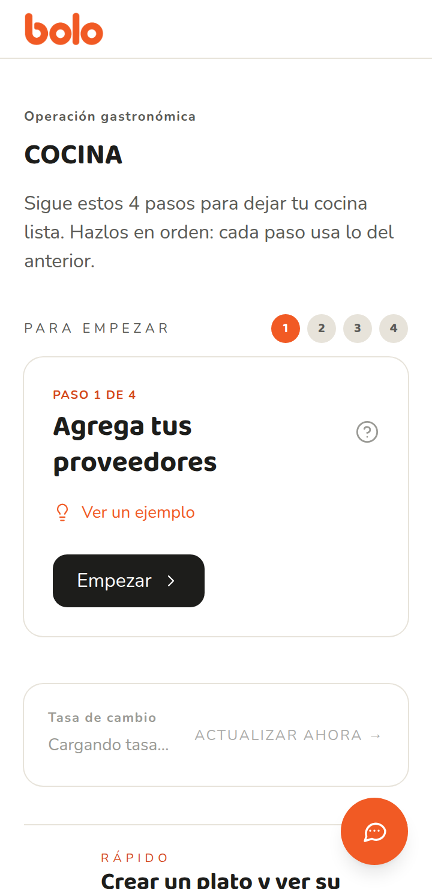
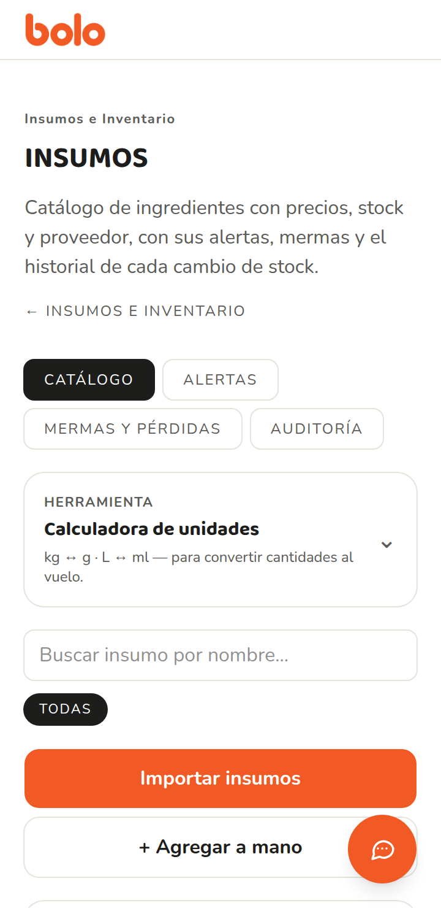
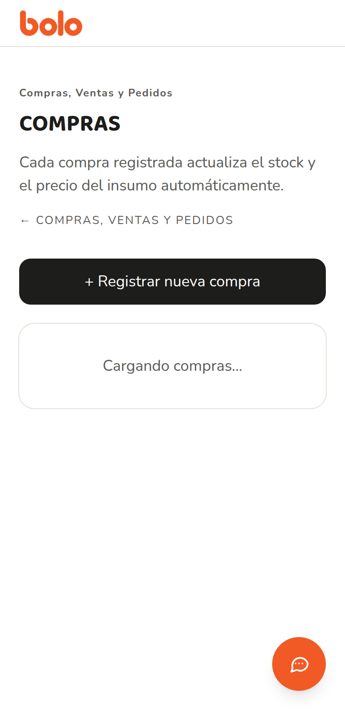
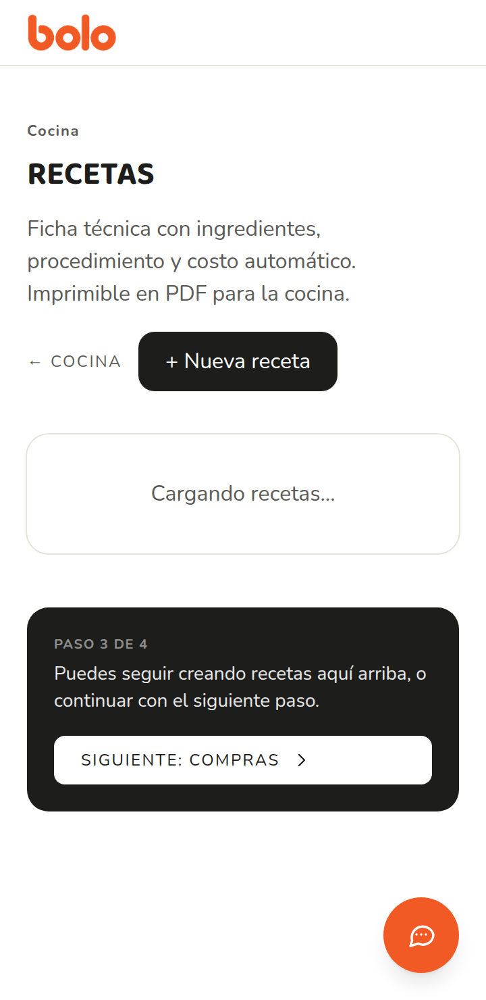
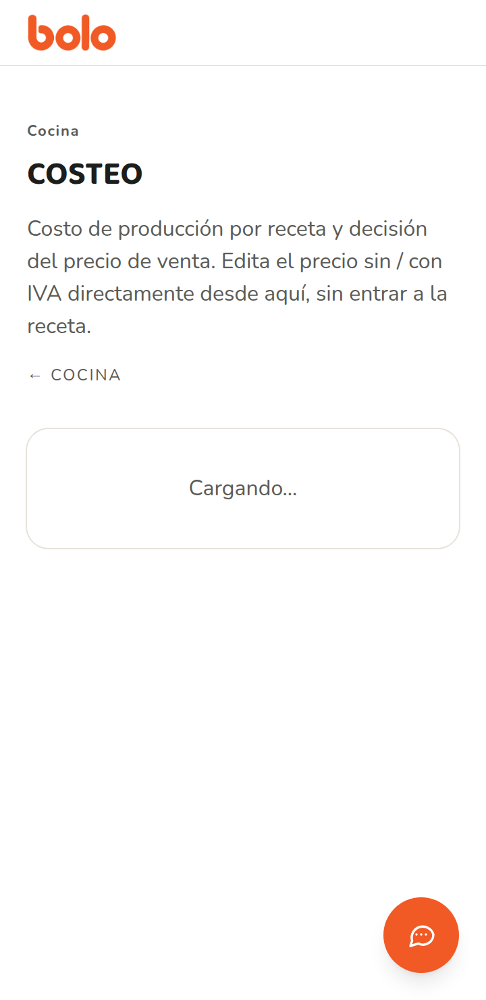

# Auditoría de cocina — 23 de octubre de 2026

Cinco pantallas: insumos, compras, recetas, costeo y «Para empezar». La vara es `docs/diseno/GUIA.md`: una tarea, texto que se lee al sol del pase, botón de 44 px, confirmación después de cada acción, palabras de cocina.

## Cómo se miró

La app sí arrancó en local (`npm run dev`), sin backend. En el repo solo está `.env.local.example`. No hay `.env.local`, así que no hay `NEXT_PUBLIC_SUPABASE_URL` ni llave anónima. El proxy deja pasar (`src/lib/supabase/middleware.ts`, líneas 26-28: sin Supabase, la app sigue). Los datos de cocina no tienen modo local: `src/lib/data/cocina.ts` llama a Supabase directo. Por eso las listas no cargan y se ve el aviso de `ErrorCarga`.

Las capturas son el viewport de 360×740 (Chrome headless, escala 2). Están en `docs/diseno/capturas/`. Muestran la cabecera, la jerarquía y el error de carga. No muestran una lista llena. Lo que depende de filas reales se auditó en el código, con archivo y línea.

En las cinco capturas, la burbuja del asistente (círculo naranja, abajo a la derecha) tapa la esquina. Sale de `src/app/cocina/layout.tsx`, que monta `AsistenteBolo` en todas las páginas de cocina.

## 1. Para empezar

Ruta: `/cocina` (`src/app/cocina/page.tsx` y `src/app/cocina/_GuiaInicio.tsx`).

### Qué funciona

- Un paso a la vez, con ejemplo de cocina. El texto de los ejemplos (`_GuiaInicio.tsx`, líneas 27-61) es el mejor tono del producto: «el señor que te vende el pollo», «3 naranjas y azúcar».
- El botón del paso dice el verbo («Empezar», «Ir a insumos») y lleva a la pantalla correcta.
- La ayuda del «?» cabe en una línea (`corto`).

### Problemas

**Alta.** En 360×740 el primer pantallazo no llega al botón «Empezar». Antes hay ceja, título en mayúsculas, un párrafo, los números y el título del paso. La burbuja tapa la esquina inferior derecha, que es donde cae ese botón al hacer scroll.

- Dónde: `src/app/cocina/page.tsx` líneas 56-67; `_GuiaInicio.tsx` líneas 115-176; `_AsistenteBolo.tsx` líneas 83-90 (`fixed bottom-5 right-5`, `size-14`, texto blanco sobre `#f15a24`).
- Propuesta, revisable en el teléfono: el primer pantallazo muestra «Paso 1 de 4», «Agrega tus proveedores» y el botón «Empezar», con 16 px de aire. La burbuja sube cuando el botón principal está visible, o se corre a la izquierda. Se comprueba que el botón entero se pueda tocar sin abrir el chat.

**Alta.** Los números de paso miden 24 px (`size-6`) y el activo es texto blanco de 11 px sobre `#f15a24` (3,37:1).

- Dónde: `_GuiaInicio.tsx` líneas 103-109.
- Propuesta: cada número es un blanco de 44 px. El activo usa texto `#1d1d1b` sobre `#f15a24`. Los otros, texto `#5b5b57` sobre `#e7e3da` (5,33:1).

**Media.** Debajo del paso siguen la tasa BCV, el atajo «Crear un plato y ver su costo» y tres módulos. Son otras tres tareas. El párrafo de arriba dice «4 pasos» y el atajo es un quinto camino, fuera de la lista.

- Dónde: `page.tsx` líneas 65-67 y 73-105; `BcvRateBanner.tsx` líneas 60-119.
- Propuesta: tasa, atajo y módulos quedan en un plegable «Ver todo», cerrado. El orden de los cuatro pasos no cambia. Si «Crear un plato» es el camino corto, se dice en una frase bajo el paso 3, no como una segunda portada.

**Media.** Las cejas van a 11 px, en mayúsculas, con tracking de 0,3 em a 0,4 em. «Operación gastronómica» no es una frase de cocina.

- Dónde: `page.tsx` líneas 58-62; `_GuiaInicio.tsx` líneas 92-93 y 116-117.
- Propuesta: quitar la ceja. El título es «Cocina», Baloo 2, 24 px, en oración, sin tracking.

**Baja.** El botón del paso es carbón con `py-2.5`, no el naranja de 44 px.

- Dónde: `_GuiaInicio.tsx` líneas 169-176.
- Propuesta: `min-h-11 w-full`, fondo `#f15a24`, texto `#1d1d1b`. Es la única acción de esa pantalla.

## 2. Insumos

Ruta: `/cocina/insumos` (`src/app/cocina/insumos/page.tsx`, `InsumosTabs.tsx`, `InsumosClient.tsx`).

### Qué funciona

- El nombre de la pantalla es «Insumos», una palabra que el jefe de cocina ya usa.
- Hay búsqueda, y el alta a mano pide el nombre con un ejemplo («Café en grano», línea 716).
- Borrar y desactivar pasan por `ConfirmDialog`, no por el `confirm()` del navegador (líneas 1154-1186).
- El precio de una fila sí dice «Precio actualizado» (`PrecioCelda`, líneas 1253-1257 y 1350-1352). Ese patrón es el que falta en el resto.

### Problemas

**Alta.** La pantalla abre cuatro tareas: Catálogo, Alertas, Mermas y pérdidas, Auditoría. Encima, la calculadora de unidades y dos botones grandes. En la captura, el aviso de error ya queda debajo del primer pantallazo.

- Dónde: `InsumosTabs.tsx` líneas 15-19 y 46-73; `InsumosClient.tsx` línea 608 (`UnitCalculator`) y líneas 678-692.
- Propuesta: al entrar se ve la lista (o el vacío) y un botón, «Agregar insumo». Alertas es un aviso de una línea si hay algo agotado (el botón de las líneas 568-591 ya existe: puede quedarse). Mermas e historial se abren desde la fila. La calculadora sigue plegada y más abajo, no entre el título y el botón.

**Alta.** El botón naranja dice «Importar insumos». Agregar a mano es el secundario. El vacío dice otra cosa: «Crea el primero con “+ Nuevo insumo”». Ese botón no existe.

- Dónde: `InsumosClient.tsx` líneas 679-690 y 986-988.
- Propuesta: un solo principal, «Agregar insumo», naranja, 44 px, ancho completo. «Importar» pasa a secundario, debajo o dentro de un plegable «Traer una lista». El vacío repite exactamente «Agregar insumo».

**Alta.** Títulos de grupo y las etiquetas «Precio» y «Stock» usan `#9a9a95` (`text-cacao-mute`), 2,83:1 sobre blanco.

- Dónde: `InsumosClient.tsx` líneas 998, 1047-1052 y 1067.
- Propuesta: `text-cacao-soft` (`#5b5b57`, 6,82:1) a 14 px. Misma revisión en cualquier `text-cacao-mute` de esta pantalla.

**Media.** El formulario de un insumo pide, de una vez, categoría, proveedor, presentación, precio, stock, stock mínimo y «Merma por procesamiento (%)», más la frase «stock libre (= total − comprometido)».

- Dónde: `InsumosClient.tsx` líneas 705-956, en particular 881-898 y 929-946.
- Propuesta: a la vista, nombre, cómo viene (la presentación) y precio. Stock, mínimo, merma y notas van en «Más datos», plegado. «Merma por procesamiento» pasa a «Lo que se pierde al prepararlo (%)». «Comprometido» pasa a «apartado», y solo si hay planes de producción.

**Media.** Al crear o editar no hay frase de confirmación. Hay un anillo naranja de 1,5 s (líneas 447-461). El botón «Crear insumo» no tiene estado «Guardando…» (`py-2`, líneas 958-962). Las acciones de cada fila miden `min-h-10` (40 px, líneas 1087-1117).

- Propuesta: banner verde «Quedó guardado: Café en grano.» hasta la siguiente acción, y `min-h-11` en Crear, Cancelar y en Pérdida / Editar / Historial. Si falla, se queda el `ErrorBanner` que ya está en la línea 566.

## 3. Compras

Ruta: `/cocina/compras` (`src/app/cocina/compras/page.tsx`, `ComprasClient.tsx`).

### Qué funciona

- La frase de la página es clara: registrar la compra actualiza stock y precio (página, líneas 18-20).
- El botón «+ Registrar nueva compra» es ancho completo y `py-3` (líneas 714-729). Es de los pocos que se acercan a 44 px. En la captura se lee entero.
- Si el precio cambia más de un 50 %, hay un diálogo «Revisa antes de guardar» con «Está bien, guardar» y «Corregir» (líneas 617-622 y 1382-1403). Eso es una buena red para un dedo apurado.
- Las compras se agrupan por día y el día se pliega (líneas 1236-1263).

### Problemas

**Alta.** Al borrar, el diálogo dice que no se devuelve el stock y que hay que ajustarlo a mano. El código de la misma pantalla dice lo contrario: el trigger resta el stock (y el precio, si era la última compra).

- Dónde: el diálogo, `ComprasClient.tsx` líneas 1409-1411. El comentario que sí coincide con la base, líneas 684-686. El trigger, `supabase/cocina-compra-revertir-al-borrar.sql` líneas 1-16.
- Propuesta, revisable leyendo el diálogo y borrando una compra de prueba: «¿Borrar esta compra? Se resta del stock lo que había entrado. Si era la compra más reciente, el precio vuelve al anterior.» El botón de confirmar es vino, no naranja.

**Alta.** Después de registrar no hay confirmación. `guardarCompra` cierra el formulario y recarga (línea 674, `resetForm`). El botón de enviar es `py-2` (líneas 1202-1206), por debajo de 44 px, y no dice «Guardando…».

- Propuesta: el botón pasa a `min-h-11` con «Guardando…» mientras espera. Al terminar, banner verde: «Quedó registrada. El precio y el stock de este insumo se actualizaron.» Si falla, el `ErrorBanner` de la línea 712 se queda.

**Alta.** Una compra nueva pide insumo, proveedor, fecha, cantidad, cómo se pagó, IVA, monto en Bs, monto en $, tasa, número de factura, flete, notas y «Pagar después». En 360 px eso pasa de dos pantallas antes de llegar a «Registrar compra».

- Dónde: `ComprasClient.tsx` líneas 875-1214. El bloque de IVA, montos y tasa está en 933-1117; factura, flete y notas, en 1120-1159; «cuenta por pagar», en 1161-1181.
- Propuesta: a la vista quedan insumo, cantidad y monto (en la moneda de la factura, el otro se calcula). «Cómo pagaste», tasa, IVA, factura, flete y «todavía no lo pagué» van en «Más datos de la factura», plegado, usando `Plegable`. La advertencia del 50 % se queda.

**Alta.** En cada compra ya guardada, Editar, Marcar pagada y Borrar son texto de 10 px, sin alto mínimo.

- Dónde: `ComprasClient.tsx` líneas 1341-1368.
- Propuesta: tres botones secundarios de `min-h-11`, en fila debajo del monto. «Borrar» en texto vino. «Marcar pagada» pasa a «Ya lo pagué».

**Media.** Se lee «Modalidad de pago», «cuenta por pagar» y «El sistema le suma el IVA».

- Dónde: líneas 934, 990-993 y 1175-1179.
- Propuesta: «Cómo pagaste», «Todavía no lo pagué» y «A este monto le sumamos el IVA para el costo». Las opciones de pago que ya están en `MODALIDADES_PAGO` (`src/lib/types.ts` líneas 575-581: «Bs · BCV $», «USD efectivo») se quedan: son las palabras del día a día.

## 4. Recetas

Ruta de la lista: `/cocina/recetas` (`page.tsx`, `RecetasList.tsx`). Crear es `/cocina/recetas/nuevo` (`RecetaForm.tsx`): entra en esta auditoría porque es la tarea del botón principal.

### Qué funciona

- El vacío, cuando la carga sí funciona, dice «Aún no hay recetas. Crea la primera.» y repite el botón (líneas 311-325).
- Buscar por nombre o por ingrediente (línea 225) es la tarea correcta de una lista.
- Al guardar desde el formulario sí hay frase: «Receta guardada (N ingredientes).» (`RecetaForm.tsx` líneas 577-581), en el verde que pasa contraste. Dura 4 segundos: corto, pero existe.
- Las sub-recetas se explican como salsa, mezcla o masa (formulario, líneas 642-644). Esa explicación vale. La palabra «batch» al lado, no.

### Problemas

**Alta.** La lista tiene dos vistas, «Fichas» y «Costeo». Costeo deja editar el precio en la fila y, si el guardado falla, el `catch` está vacío: el número cambia en la pantalla y no se avisa.

- Dónde: `RecetasList.tsx` líneas 279-291 (el cambio de vista) y 203-212 (el `catch` vacío). El input de precio mide `h-9` (36 px), líneas 379-393.
- Propuesta: esta pantalla solo busca y abre la receta. El precio se edita en Costeo. Se borra el interruptor Fichas/Costeo. Si el precio se queda aquí por un tiempo, un fallo muestra `ErrorBanner` y el número vuelve al que sí se guardó. El campo mide `min-h-11`.

**Alta.** El semáforo de esa vista no llega a 4,5:1.

- Dónde: `RecetasList.tsx` líneas 361-365.
- Medido: «Buena ganancia», `#2E9E5B` sobre `#E4F3EA`, 2,97:1. «Cuidado», `#A16207` sobre `#FBEEDD`, 4,31:1. «Casi no ganas», `#D64534` sobre `#FBE5E1`, 3,65:1.
- Propuesta: los tres pares de la guía (verde `#2F4A1F` / `#F1F4ED`, ámbar `#7A5A18` / `#FBF3E2`, vino `#7A2419` / `#F9EBE7`) y las palabras «Te queda bien», «Queda justo», «Casi no te queda». El mismo semáforo en Recetas, Costeo y Rentabilidad.

**Media.** En el teléfono el botón «+ Nueva receta» comparte fila con «← Cocina» y con un título en mayúsculas espaciadas. Es `py-2.5` y carbón, no el naranja de 44 px. La ceja de cada ficha y «P. sugerido» van a 10 px en `#9a9a95`.

- Dónde: `src/app/cocina/recetas/page.tsx` líneas 14-37; `RecetasList.tsx` líneas 426-431 y 452-490 (`/porc.`, `s/IVA`, `c/IVA`, `margen`).
- Propuesta: título «Recetas» a 24 px sin mayúsculas. El botón, ancho completo, debajo del título, naranja, `min-h-11`, texto «Nueva receta». En la ficha: «Costo $1,20 por porción», «Precio $4,00 sin IVA», a 14 px en `#5b5b57` como mínimo para lo secundario y `#1d1d1b` para el número.

**Media.** El formulario de alta abre con la calculadora de unidades y sigue con tipo, datos, precio, sub-recetas, ingredientes, líneas y preparación. «1 batch» aparece en el rendimiento.

- Dónde: `RecetaForm.tsx` línea 610 (calculadora), 613-677 (tipo), 651 («batch»), 681 en adelante (datos, precio, ingredientes), 1388 (preparación). Los botones finales son `py-2.5` (líneas 1432-1450).
- Propuesta: a la vista, nombre, porciones e ingredientes, y el costo que va saliendo. Tipo «preparación», perfil, procedimiento y variaciones van plegados. «Cuánto rinde» en vez de «batch». Botones a `min-h-11`. El banner verde se queda hasta que la persona sigue, no 4 segundos.

## 5. Costeo

Ruta: `/cocina/costeo` (`page.tsx`, `CosteoClient.tsx`).

### Qué funciona

- La página dice para qué es: costo del plato y precio de venta, sin entrar a la receta (página, líneas 18-21).
- Al cambiar un precio sí hay frase, «Precio actualizado.», y si falla hay `ErrorBanner` (líneas 147-162 y 200-204).
- Separa «con precio» y «sin precio» (líneas 307-350). Lo que falta por cargar se puede ver de un golpe, cuando la tabla no obliga a scrollear de lado.
- Hay aviso si el precio de un insumo tiene más de 90 días (`PRECIO_VIEJO_DIAS` en `src/lib/types.ts` línea 486; el banner, `CosteoClient.tsx` líneas 207-217).

### Problemas

**Alta.** La decisión está en una tabla de cinco columnas con scroll horizontal: receta, costo, sugerido, precio sin IVA y precio con IVA. En 360 px no se compara un plato sin mover la tabla de lado. Los encabezados van a 10 px en `#9a9a95` (2,83:1).

- Dónde: `CosteoClient.tsx` líneas 307-324 (`overflow-x-auto`) y 392-404 (las cinco columnas). El input es `py-1` (línea 533).
- Propuesta, revisable en 360 px sin scroll horizontal: una tarjeta por receta. Línea 1, el nombre. Línea 2, «Te cuesta $1,20». Línea 3, el precio editable a `min-h-11`. Línea 4, el pill «Te queda bien / Queda justo / Casi no te queda». «Ver la cuenta» abre el desglose (costo, IVA, precio para la ganancia que quieres) y se puede editar ahí. La segunda columna de precio (con IVA) vive en ese desglose, no al lado.

**Alta.** Arriba de la lista está «Parámetros del costeo», «Food cost objetivo» y, al editar, «costo / target» (`ConfigEditor`, línea 569). Es jerga de costo, no de cocina. La página manda el semáforo a Rentabilidad (líneas 368-375) mientras Recetas pinta otro distinto.

- Dónde: `CosteoClient.tsx` líneas 220-265 y 548-585.
- Propuesta: ese bloque nace plegado, con el título «Cómo calculamos el precio». Adentro: «Del precio, un 30 % se va en ingredientes» y «IVA 16 %». Sin la palabra «food cost» ni «target». El pill de ganancia es el de la guía, en esta pantalla, no un enlace a otra.

**Media.** «Precio actualizado.» se borra solo a los 3 segundos (líneas 80-84). En un pase, con el teléfono en la mano, es fácil no verlo. Los títulos de sección van a 12 px con tracking 0,3 em en `#9a9a95` (línea 224).

- Propuesta: el banner verde se queda hasta la siguiente acción. Los títulos de bloque pasan a Baloo 2, 20 px, `#1d1d1b`.

**Baja.** El vacío de «sin resultados» está bien («Aún no tienes recetas para costear», líneas 353-366). El título de la página sigue en mayúsculas con tracking (`page.tsx` líneas 15-16), igual que las otras cuatro.

## Top 10

Orden: primero lo que más cambia el uso en el teléfono; si el impacto es parecido, va antes lo que se revisa en un solo archivo.

| # | Cambio | Impacto | Esfuerzo | Se revisa en |
| --- | --- | --- | --- | --- |
| 1 | El diálogo de borrar una compra dice la verdad: el stock sí se resta. Botón vino. | Alto | Bajo | `ComprasClient.tsx` 1409-1411, contra el trigger de `cocina-compra-revertir-al-borrar.sql` |
| 2 | En Insumos, el botón naranja es «Agregar insumo». El vacío usa esas mismas palabras. Importar queda secundario. | Alto | Bajo | `InsumosClient.tsx` 679-690 y 986-988 |
| 3 | 44 px de alto en los números de «Para empezar» y en Editar / Ya lo pagué / Borrar de cada compra. | Alto | Bajo | `_GuiaInicio.tsx` 103-109; `ComprasClient.tsx` 1341-1368 |
| 4 | Confirmación que no se esconde, y error que no se traga. El `catch` vacío del precio en Recetas muestra `ErrorBanner` y revierte el número. Compras e Insumos dicen «Quedó guardado» en el banner verde. | Alto | Bajo | `RecetasList.tsx` 203-212; `ComprasClient.tsx` 674; `InsumosClient.tsx` 447-461 |
| 5 | Ningún texto en `#9a9a95`. Pasa a `#5b5b57` y, como mínimo, a 14 px. Empieza por títulos de grupo, «Precio», «Stock» y los encabezados de la tabla de costeo. | Alto | Medio | `InsumosClient.tsx` 998 y 1052; `CosteoClient.tsx` 224 y 394; `RecetasList.tsx` 426 |
| 6 | Texto `#1d1d1b` sobre `#f15a24` en el botón principal, en el paso activo y en la burbuja si algún día lleva palabra. El blanco sobre naranja se queda en 3,37:1. | Alto | Medio | `_GuiaInicio.tsx` 105 y 169; `_AsistenteBolo.tsx` 88 y 119-121; botones `bg-terracotta text-white` |
| 7 | Costeo en tarjetas: te cuesta, precio, lo que te queda. La tabla de cinco columnas pasa al desglose plegado. Sin scroll horizontal en 360 px. | Alto | Medio | `CosteoClient.tsx` 307-350 y 381-461 |
| 8 | La compra nueva muestra insumo, cantidad y monto. Tasa, IVA, factura, flete y «todavía no lo pagué» van plegados. | Alto | Medio | `ComprasClient.tsx` 875-1214 |
| 9 | Recetas solo lista y abre. Se quita la vista Costeo de la lista. El semáforo, donde siga, usa los tres pares que sí pasan 4,5:1, con las mismas palabras en Costeo y en Rentabilidad. | Alto | Medio | `RecetasList.tsx` 279-291 y 361-365 |
| 10 | «Para empezar» cabe el paso y el botón en el primer pantallazo de 360×740. Tasa, «Crear un plato» y módulos van plegados. La burbuja no tapa «Empezar». | Alto | Medio | `page.tsx` 56-105; `_GuiaInicio.tsx` 169-176; `_AsistenteBolo.tsx` 83-90 |

Queda fuera del top 10, y conviene hacerlo al tocar la cabecera global: dejar de pedir diez archivos de fuente a Google y quitar el `backdrop-blur` de `Header.tsx` línea 22. Es rendimiento, no una pantalla.

## Dudas para Lucía

1. El naranja de marca se queda en `#f15a24` y el texto del botón pasa a `#1d1d1b` (5,01:1). La otra salida es un naranja más oscuro, `#c2410c`, con texto blanco (5,18:1). ¿Cuál de las dos?

2. ¿«Insumo» se queda en el menú, o en alguna tienda lo dicen «ingrediente» o «producto»?

3. «Crear un plato y ver su costo» hoy es un atajo al lado de los cuatro pasos. ¿Es el camino corto para alguien que ya tiene insumos, o debería ser el paso 1?

4. ¿La vista «Costeo» dentro de Recetas se retira y el precio vive solo en `/cocina/costeo`?

5. Food cost e IVA: ¿los toca el jefe de cocina en el día a día, o solo el dueño? De eso depende si «Cómo calculamos el precio» nace plegado.

6. El lector de facturas, cuando exista: ¿reemplaza el formulario largo de Compras o es un segundo camino, al lado de «Registrar a mano»?

7. Esta pasada no tuvo datos. ¿Hay un proyecto de Supabase de prueba para repetir las cinco capturas con listas llenas y mirar el scroll real?
